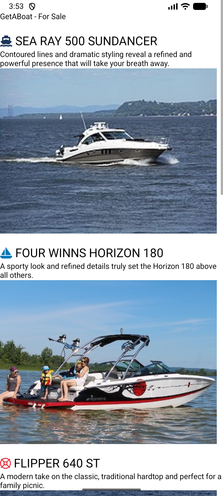
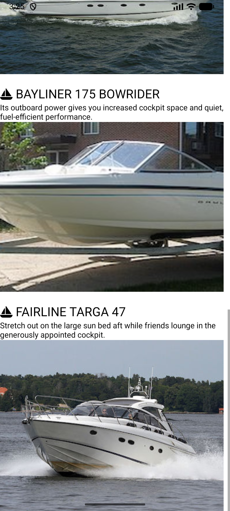

<!-- Create a file README.MD in L04Boats folder and paste following content in it -->
# GetABoat

GetABoat is a mobile app for GetABoat, a local SME (Small Medium Enterprise) and authorised power boat dealer.
This first phase of the app shows a product page listing the 6 powerboats they are selling. Each boat shows its name, a boat icon, a short description and a photo, and users can scroll down to browse all the boats.
It is built with React Native (Expo) and uses a custom Boat component (components/Boat.js) that App.js reuses for each boat.

# ScreenShots of App
Top page screenshot:  

Bottom page screenshot:  

